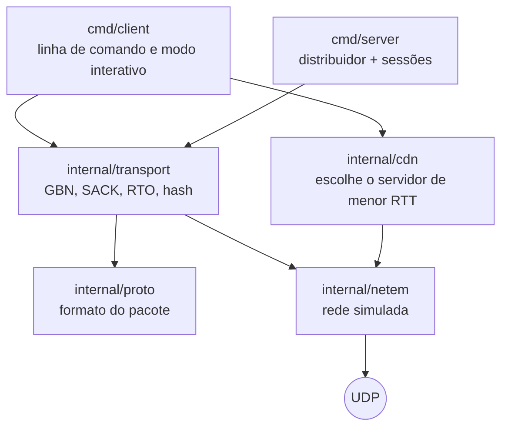
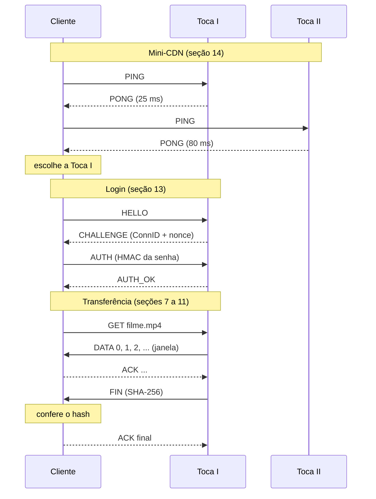
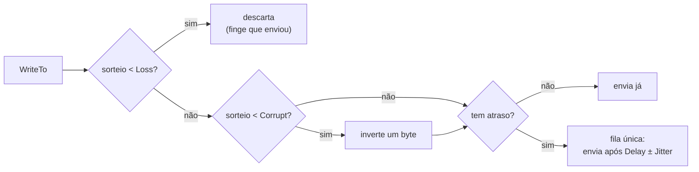
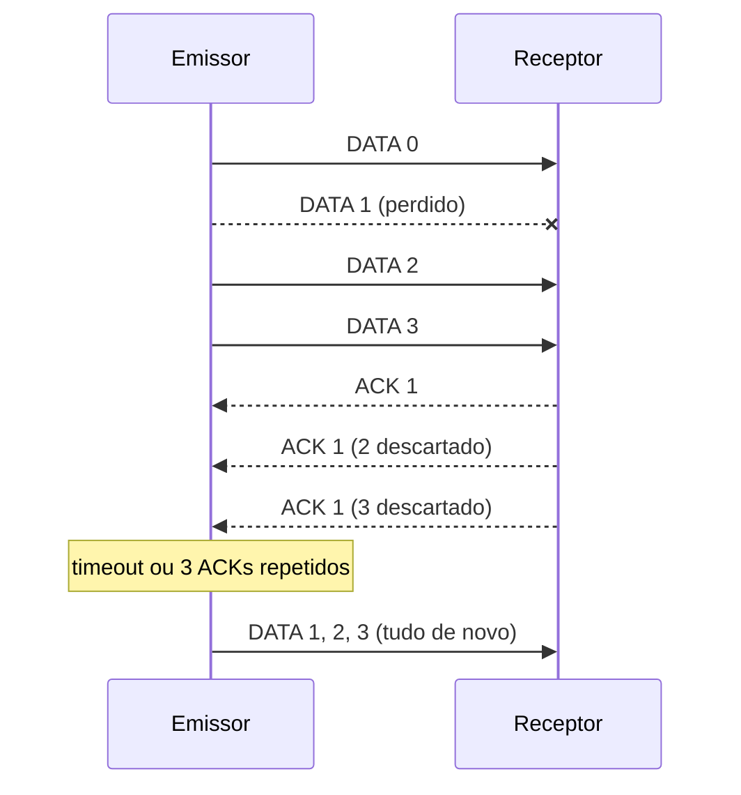
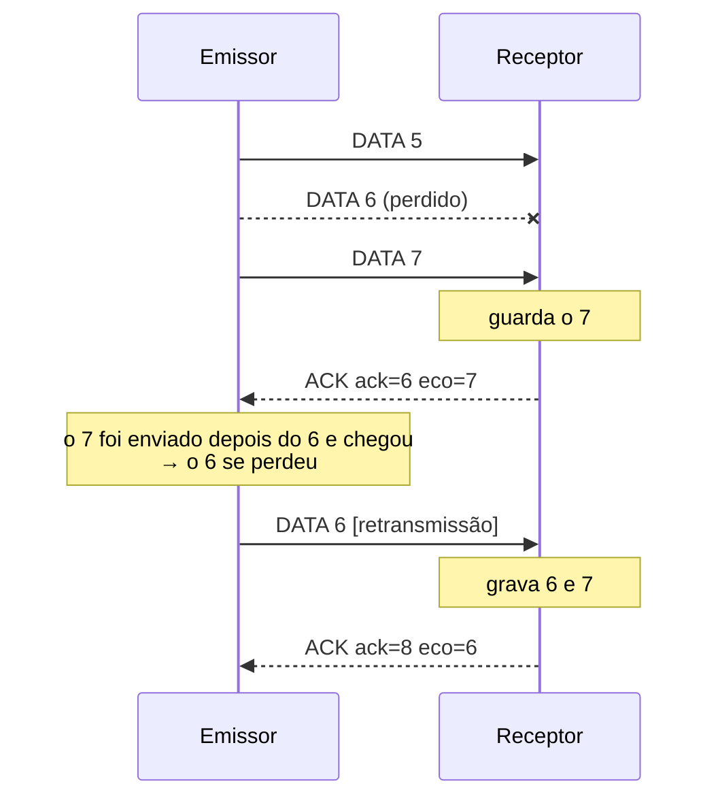
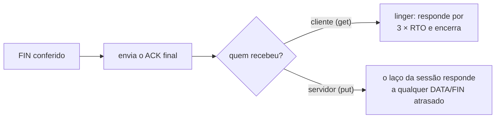
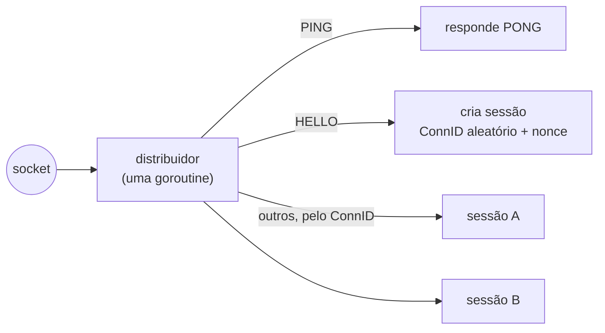
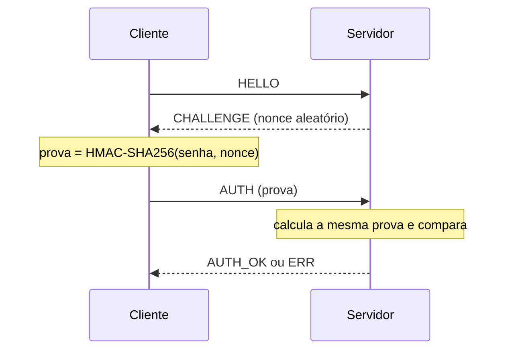
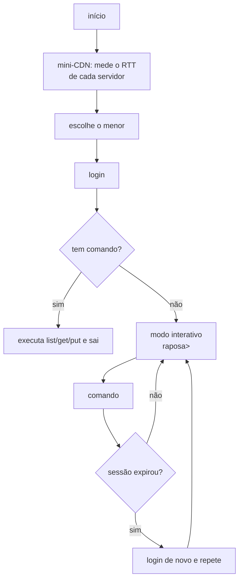
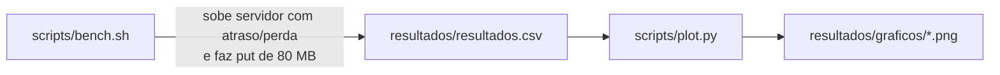

# RAPOSA explicado

Este documento percorre o projeto na ordem em que as coisas acontecem: do
pacote até o download completo. Cada seção diz o que a parte faz e mostra
o trecho de código que importa. Trechos marcados como *simplificado* foram
encurtados; o código completo está no arquivo indicado.

## Sumário

1. [Mapa do projeto](#1-mapa-do-projeto)
2. [Um download, do início ao fim](#2-um-download-do-início-ao-fim)
3. [O pacote](#3-o-pacote)
4. [O simulador de rede](#4-o-simulador-de-rede)
5. [Link: a conversa com o outro lado](#5-link-a-conversa-com-o-outro-lado)
6. [Cortando o arquivo em pacotes](#6-cortando-o-arquivo-em-pacotes)
7. [Janela deslizante](#7-janela-deslizante)
8. [Go-Back-N](#8-go-back-n)
9. [Selective Repeat com SACK](#9-selective-repeat-com-sack)
10. [RTO adaptativo](#10-rto-adaptativo)
11. [Recebendo e conferindo o hash](#11-recebendo-e-conferindo-o-hash)
12. [Pedidos e respostas sobre UDP](#12-pedidos-e-respostas-sobre-udp)
13. [O servidor](#13-o-servidor)
14. [O cliente](#14-o-cliente)
15. [Tratamento de erros](#15-tratamento-de-erros)
16. [Medições e experimentos](#16-medições-e-experimentos)
17. [Wireshark](#17-wireshark)
18. [Go em poucas palavras](#18-go-em-poucas-palavras)

---

## 1. Mapa do projeto



Cada camada só conhece a de baixo:

| Camada | Responsabilidade |
|---|---|
| `proto` | transformar um pacote em bytes e de volta, e detectar corrupção |
| `netem` | simular atraso, perda e corrupção |
| `transport` | entregar um arquivo inteiro, em ordem e sem erros |
| `cdn` | medir o RTT e escolher o servidor |
| `cmd/*` | a aplicação: login, list, get, put |

---

## 2. Um download, do início ao fim

Visão geral antes dos detalhes. Cada etapa é explicada nas próximas seções.



---

## 3. O pacote

**Arquivo:** `internal/proto/packet.go`. Especificação completa em [header.md](header.md).

Todo pacote tem um cabeçalho de 30 bytes seguido de até 1200 bytes de dados.

```go
type Packet struct {
    Type    Type    // DATA, ACK, GET, ...
    Flags   uint8   // bit 0 = retransmissão
    Window  uint16  // janela anunciada pelo receptor
    ConnID  uint32  // identifica a sessão
    Seq     uint32  // número de sequência
    Ack     uint32  // "recebi tudo abaixo de Ack"
    Sack    uint64  // bitmap: quais pacotes recentes chegaram
    Payload []byte
}
```

`Marshal` grava os campos em bytes (big-endian) e calcula o **CRC-32**
do pacote inteiro. `Unmarshal` recalcula o CRC e **descarta** o pacote
se ele não bater:

```go
if crc32.ChecksumIEEE(withoutChecksum) != received {
    return nil, ErrBadChecksum
}
```

Um pacote corrompido é tratado como **perdido**: quem recebe simplesmente
o ignora, e a retransmissão resolve.

---

## 4. O simulador de rede

**Arquivo:** `internal/netem/netem.go`

O enunciado permite simular a rede na própria aplicação. O `netem.Conn`
"embrulha" o socket e só muda o envio:



- Cada lado aplica o atraso **nos seus envios**. Então RTT = atraso do cliente + atraso do servidor. Para um RTT de 100 ms, use `-delay 50ms` nos dois.
- A **fila única** mantém a ordem dos pacotes. Se cada pacote tivesse o próprio timer, eles poderiam sair trocados.

---

## 5. Link: a conversa com o outro lado

**Arquivo:** `internal/transport/link.go`

Os algoritmos não falam com o socket diretamente. Eles usam esta interface:

```go
type Link interface {
    Send(packet *proto.Packet) error
    Receive(deadline time.Time) (*proto.Packet, error) // timeout = os.ErrDeadlineExceeded
}
```

| Implementação | Onde | Como recebe |
|---|---|---|
| `UDPLink` | cliente | lê o socket; ignora pacotes de outros endereços ou de outra sessão |
| `ChannelLink` | servidor | recebe de uma fila (`Inbox`) alimentada pelo distribuidor |
| `memoryLink` | testes | fila em memória, com perda sorteada |

Com isso, o mesmo código de GBN/SACK roda no cliente, no servidor e nos testes.

---

## 6. Cortando o arquivo em pacotes

**Arquivo:** `internal/transport/stream.go` (`packetSource.Next`)

O emissor lê o arquivo em pedaços de 1200 bytes. Cada pedaço vira um `DATA`
com o próximo número de sequência. No fim, vem um `FIN` que leva o
**SHA-256** de tudo o que foi enviado:

```go
bytesRead, err := io.ReadFull(source.input, source.chunk)

packet := &proto.Packet{Type: proto.TypeData, Seq: source.nextSeq}
if bytesRead > 0 {
    packet.Payload = append([]byte(nil), source.chunk[:bytesRead]...)
} else {
    packet.Type = proto.TypeFin
    packet.Payload = source.hasher.Sum(nil) // SHA-256 do arquivo
    source.finished = true
}
source.nextSeq++
```

O hash é calculado enquanto o arquivo é lido (`io.TeeReader`), sem ler o
arquivo duas vezes.

```
Seq:   0      1      2     ...   N-1     N
     [DATA] [DATA] [DATA]  ...  [DATA] [FIN + SHA-256]
```

---

## 7. Janela deslizante

Esperar um ACK por pacote (Stop-and-Wait) dá no máximo `1200 bytes / RTT`:
com 100 ms de RTT, são 12 KB/s. A janela deslizante deixa **N pacotes no ar**
ao mesmo tempo.

```
Seq:     0   1   2   3   4   5   6   7   8   9
       [ok][ok][  ][  ][  ][  ][  ][  ][  ][  ]
                ^base               ^nextSeq
                |<---- no ar ------>|<-- pode enviar se couber na janela
```

- `base`: o pacote mais antigo ainda sem confirmação;
- `nextSeq`: o próximo pacote novo;
- pode enviar enquanto `nextSeq - base < janela`.

**Limite teórico:** `throughput ≤ janela × 1200 bytes / RTT`. Por isso a janela
precisa ser grande nos cenários de RTT alto.

O laço do emissor é igual nos dois algoritmos (*simplificado*):

```go
for {
    // 1. envia pacotes novos enquanto couber na janela
    for !sender.source.finished && sender.windowHasRoom() {
        packet, _ := sender.source.Next()
        sender.sendNewPacket(packet)
    }
    // 2. acabou? (FIN enviado e tudo confirmado)
    if sender.source.finished && sender.base == sender.nextSeq {
        return nil
    }
    // 3. espera um ACK até o timer estourar
    ack, err := sender.link.Receive(sender.timerDeadline)
    if errors.Is(err, os.ErrDeadlineExceeded) {
        sender.handleTimeout()
        continue
    }
    // 4. processa o ACK
    sender.handleAck(ack)
}
```

O que muda entre GBN e SACK é o que fazem `handleAck` e `handleTimeout`.

---

## 8. Go-Back-N

**Arquivo:** `internal/transport/gbn.go`

**Receptor:** aceita só o pacote esperado. Qualquer outro é descartado, e ele
repete o último ACK.

**ACK cumulativo:** `Ack = X` quer dizer "tenho tudo até X−1, mande o X".

**Emissor:**

```go
if ack.Ack == sender.base {          // ACK repetido: o base se perdeu
    sender.duplicateAcks++
    if sender.duplicateAcks == 3 {   // fast retransmit
        return sender.resendWholeWindow()
    }
    return nil
}
sender.slideWindowTo(ack.Ack)        // ACK novo: desliza a janela
```

No timeout, também reenvia **a janela inteira**. Daí o nome *Go-Back-N*.



**Vantagem:** é simples. **Problema:** com 5% de perda, quase toda janela
tem um buraco, e cada buraco reenvia a janela toda. No cenário 3, 78% dos
pacotes enviados eram retransmissões.

---

## 9. Selective Repeat com SACK

**Arquivo:** `internal/transport/sack.go`

Duas mudanças em relação ao GBN:

1. o receptor **guarda** os pacotes fora de ordem;
2. o emissor reenvia **só** os pacotes que faltam.

### Receptor

*Simplificado:*

```go
buffered[packet.Seq] = packet            // guarda, mesmo fora de ordem

for {                                    // grava tudo o que ficou contíguo
    next, found := buffered[receiver.expected]
    if !found {
        break
    }
    delete(buffered, receiver.expected)
    receiver.write(next)                 // grava e faz expected++
}
sendAck(packet.Seq)
```

### O que vai no ACK

| Campo | Significado |
|---|---|
| `Ack` | cumulativo: tenho tudo abaixo disto |
| `Seq` | **eco**: o pacote que gerou este ACK (então ele chegou) |
| `Sack` | 64 bits: bit *i* = "também tenho o pacote `Seq − 1 − i`" |

O bitmap é **redundância**: se o ACK do pacote 500 se perder, o ACK do 501
avisa, pelo bit 0, que o 500 chegou.

### Como o emissor descobre uma perda

**Regra (ideia do RACK do TCP, RFC 8985):** se chegou um pacote enviado
*depois* de P, então P se perdeu. Damos uma folga de RTT/4, caso a rede
troque a ordem dos pacotes.

```go
reorderTolerance := max(sender.rto.SmoothedRTT()/4, time.Millisecond)
lostIfSentBefore := sender.latestDeliveredSentAt.Add(-reorderTolerance)

for seq := sender.base; seq < sender.nextSeq; seq++ {
    pending := sender.inFlight[seq]
    if pending.sacked || !pending.sentAt.Before(lostIfSentBefore) {
        continue
    }
    sender.retransmit(pending)   // reenvia SÓ este
}
```

Quando o pacote é reenviado, seu `sentAt` vira "agora". Assim, se a
retransmissão também se perder, a mesma regra a detecta de novo, sem
esperar o timeout.



**Timeout:** se nada novo for confirmado por um RTO inteiro, reenvia tudo o
que está sem confirmação há mais de um RTO.

**Resultado no cenário 3 (100 ms, 5%):** SACK a 76 Mbit/s com 5%
retransmitido, contra GBN a 1,4 Mbit/s com 78% retransmitido.

---

## 10. RTO adaptativo

**Arquivo:** `internal/transport/rto.go`

O RTO precisa ser um pouco maior que o RTT. Como o RTT varia de 25 a 400 ms
entre os cenários, ele é calculado a partir das medições, como no TCP:

```go
estimator.rttvar = (3*estimator.rttvar + difference) / 4 // quanto o RTT varia
estimator.srtt = (7*estimator.srtt + sample) / 8         // média suavizada

rto = estimator.srtt + 4*estimator.rttvar                // mínimo 200 ms
```

(`difference` é `|srtt − sample|`.)

- **Medição:** pelo eco do ACK. O emissor sabe exatamente qual pacote gerou cada ACK.
- **Regra de Karn:** não mede pacotes retransmitidos, porque não dá para saber a qual envio o ACK se refere.
- **Backoff:** a cada timeout, o RTO dobra, até chegar uma medição nova.

---

## 11. Recebendo e conferindo o hash

**Arquivo:** `internal/transport/stream.go` (`streamReceiver`)

O receptor calcula o SHA-256 enquanto grava (`io.MultiWriter`). Quando o FIN
chega na ordem certa, compara o hash dele com o que o emissor mandou
(*simplificado*):

```go
if !bytes.Equal(result.SenderSHA256[:], result.ReceivedSHA256[:]) {
    link.Send(proto.NewErrorPacket(proto.ErrCodeHashMismatch, "..."))
    return result, erro // NÃO confirma o FIN
}
result.FinalReply = sendAck(fin.Seq) // confirma o FIN
```

Como o emissor só termina com sucesso quando o FIN é confirmado, **uma
transferência concluída é uma transferência com o hash conferido**.

### A confirmação final pode se perder

Se o último ACK se perder, o emissor vai reenviar o FIN ou algum DATA.
Então o receptor ainda precisa responder um tempo depois do fim:



O servidor não fica parado esperando, para que o próximo pedido do cliente
seja atendido na hora.

---

## 12. Pedidos e respostas sobre UDP

Em UDP qualquer pacote pode se perder, inclusive um `GET` ou um `AUTH_OK`.
Três mecanismos cuidam disso:

**a) `Exchange`:** envia o pedido e, se a resposta demorar, envia de novo
(*simplificado*).

```go
for attempt := 0; attempt <= maxRetries; attempt++ {
    link.Send(request)
    reply, err := link.Receive(time.Now().Add(rto))
    if errors.Is(err, os.ErrDeadlineExceeded) {
        continue // demorou: tenta de novo
    }
    if reply.Type == proto.TypeErr {
        return nil, proto.ParseError(reply)
    }
    return reply, nil
}
```

**b) Número do pedido:** cada pedido leva um número no campo `Seq`. Se o
servidor recebe um número que já tratou (a resposta se perdeu e o cliente
repetiu), ele **reenvia a resposta guardada** em vez de executar de novo.

```go
if packet.Seq <= current.lastRequestID {
    if current.lastReply != nil {
        current.link.Send(current.lastReply)
    }
    continue
}
```

**c) Pedido que inicia uma transferência:** no `GET`, a "resposta" é o
próprio primeiro `DATA`. Enquanto nenhum dado chega, o receptor reenvia o
`GET` (opção `Request`). No `PUT`, se o `OK` do servidor se perder, o
cliente repete o `PUT`, e o servidor reenvia o `OK` (opção `Reply`).

---

## 13. O servidor

**Arquivos:** `cmd/server/main.go` e `cmd/server/session.go`

### Distribuidor e sessões



- O **distribuidor** lê todos os pacotes e entrega cada um à sessão do `ConnID` dele.
- Cada **sessão** roda em paralelo (goroutine) e atende um cliente.
- Um pacote com `ConnID` certo vindo de **outro endereço** é ignorado. Isso impede que alguém que leu o `ConnID` na rede use a sessão de outra pessoa.

### Login sem enviar a senha



```go
expected := proto.AuthProof(current.server.password, current.nonce)
if hmac.Equal(packet.Payload, expected) { // comparação em tempo constante
    current.authenticated = true
    current.reply(&proto.Packet{Type: proto.TypeAuthOK})
}
```

A senha nunca passa pela rede. Como o nonce muda a cada conexão, copiar a
prova capturada não serve para nada. Depois de 3 senhas erradas, a sessão é
encerrada.

### Comandos

| Pedido | O servidor faz |
|---|---|
| `LIST` | monta `nome<TAB>tamanho` de cada arquivo da pasta e **envia como uma transferência** |
| `GET` | confere o nome, abre o arquivo e envia (o servidor é o emissor) |
| `PUT` | responde `OK`, recebe num arquivo temporário e só **renomeia se o hash conferir** |

**Nome seguro:** só aceita um nome simples, então `../../etc/passwd` é recusado:

```go
if name == "" || name != filepath.Base(name) || strings.HasPrefix(name, ".") {
    current.replyError(proto.ErrCodeInvalidName, ...)
}
```

---

## 14. O cliente

**Arquivos:** `cmd/client/` (`main.go`, `commands.go`, `shell.go`)

### Fluxo



### Mini-CDN

**Arquivo:** `internal/cdn/cdn.go`

1. Para cada servidor, envia 5 `PING`s e mede o tempo até cada `PONG`.
2. Usa a **mediana** dos tempos: um ping atrasado não distorce o resultado.
3. Escolhe o servidor com o menor RTT.

```go
sort.Slice(samples, func(i, j int) bool { return samples[i] < samples[j] })
measurement.RTT = samples[len(samples)/2] // mediana
```

É o mesmo princípio das CDNs: mandar o cliente para a réplica "mais perto"
em atraso. As CDNs reais fazem isso via DNS ou anycast, usando medições de
muitos clientes.

### Modo interativo

Usa a biblioteca `github.com/ergochat/readline`: histórico com as setas, TAB
para completar comandos e nomes de arquivos, e senha mascarada.

Comandos: `ls`, `get`, `put`, `ping`, `algo`, `janela`, `status`, `ajuda`, `sair`.

---

## 15. Tratamento de erros

| Falha | Como é detectada | O que acontece |
|---|---|---|
| Pacote corrompido | CRC-32 não confere | descartado; a retransmissão resolve |
| Pacote perdido | eco/SACK, ACK repetido ou timeout | retransmissão |
| Arquivo chegou diferente | SHA-256 no FIN | `ERR hash divergente`; o arquivo é apagado |
| Servidor fora do ar | nenhum PONG | "nenhum servidor respondeu ao ping" |
| Outro lado parou no meio | 20 timeouts seguidos ou 15 s de silêncio | erro com mensagem |
| Senha errada | HMAC diferente | `ERR senha inválida` |
| Arquivo inexistente / nome inválido | checagem no servidor | `ERR` com código e mensagem |
| Sessão expirada | `ConnID` desconhecido | o cliente faz login de novo sozinho |
| Erro inesperado no servidor | `recover` | só aquela sessão cai |

Os erros viajam num pacote `ERR`: 1 byte de código + mensagem. No cliente,
eles viram erros comuns do Go e aparecem em vermelho.

---

## 16. Medições e experimentos

| Métrica | Como é medida |
|---|---|
| RTT | pings da mini-CDN, e eco dos ACKs durante a transferência |
| Throughput | bytes ÷ tempo até o FIN ser confirmado |
| Retransmissões | contador do emissor (fast retransmit + timeouts) |
| Perda | descartes do simulador; com SACK, retransmissões ÷ pacotes ≈ taxa de perda |



```bash
scripts/bench.sh                     # 4 cenários com SACK
ALGO=gbn WINDOW=64 scripts/bench.sh  # os mesmos com GBN
MODE=janela scripts/bench.sh         # efeito do tamanho da janela
python3 scripts/plot.py              # gráficos
```

Resultados de uma execução (SACK com janela 4096, arquivo de 80 MB):

| Cenário | Throughput | Retransmitido |
|---|---:|---:|
| 1: 25 ms, 0% | 236 Mbit/s | 0% |
| 2: 100 ms, 0% | 230 Mbit/s | 0% |
| 3: 100 ms, 5% | 76 Mbit/s | 5% |
| 4: 400 ms, 5% | 19 Mbit/s | 5% |

---

## 17. Wireshark

**Arquivo:** `tools/wireshark/raposa.lua`

```bash
wireshark -X lua_script:tools/wireshark/raposa.lua
```

Mostra cada pacote decodificado:

```
GET seq=2 (sack | 4096 | filme.mp4)
DATA seq=4 len=1200
DATA seq=5 len=1200 [RETRANSMISSÃO]
ACK ack=5 eco=9 win=4096 sack=[...]
ERR seq=0: arquivo não encontrado
```

Filtros úteis: `raposa.flags.retrans == 1` (retransmissões) e
`raposa.type == 13 || raposa.type == 14` (pings da mini-CDN).

A perda do simulador acontece **antes** do socket, então não aparece na
captura. Para capturar perdas, use `tc netem` do Linux (veja o README).

---

## 18. Go em poucas palavras

O que aparece no projeto e é diferente de outras linguagens:

| Conceito | Exemplo | Explicação |
|---|---|---|
| Erro como valor | `file, err := os.Open(p)` | não há exceções: a função devolve o erro e você confere `if err != nil` |
| `:=` | `count := 0` | declara a variável e deduz o tipo |
| Método | `func (sender *gbnSender) transmit()` | `sender` funciona como o `this` |
| Ponteiro | `&Stats{}`, `*Stats` | passa o original, não uma cópia |
| Maiúscula = público | `SendGBN` × `newPacketSource` | não existem `public` e `private` |
| Interface implícita | `Link` | basta ter os métodos; não se declara `implements` |
| Embedding | `netem.Conn` contém `net.PacketConn` | "herda" os métodos do socket |
| Goroutine | `go newSession.run()` | roda em paralelo, como uma thread leve |
| Channel | `target.link.Inbox <- packet` | fila segura entre goroutines |
| `select` | pacote ou timer | espera o que acontecer primeiro |
| `defer` | `defer file.Close()` | executa ao sair da função |
| `recover` | na sessão | captura um `panic` para não derrubar o programa |
| Closure | `sendAck := func(...)` | função dentro de função, que enxerga as variáveis de fora |
