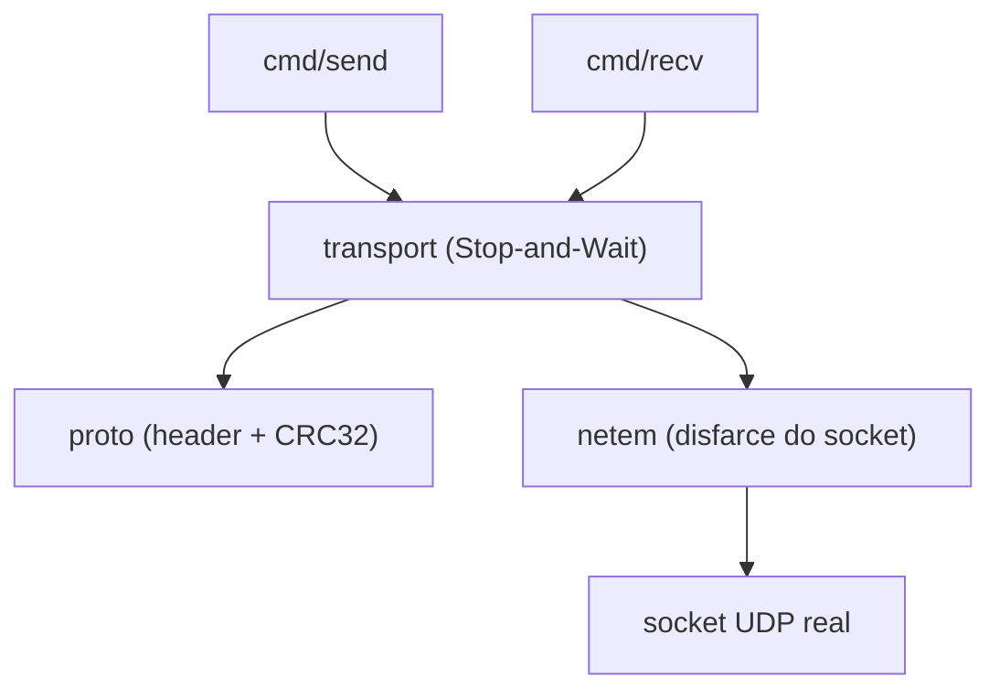
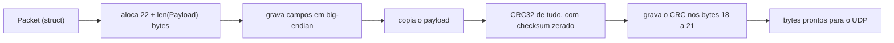
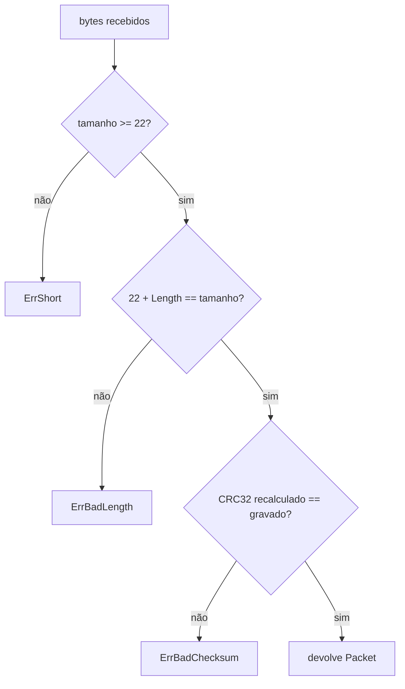
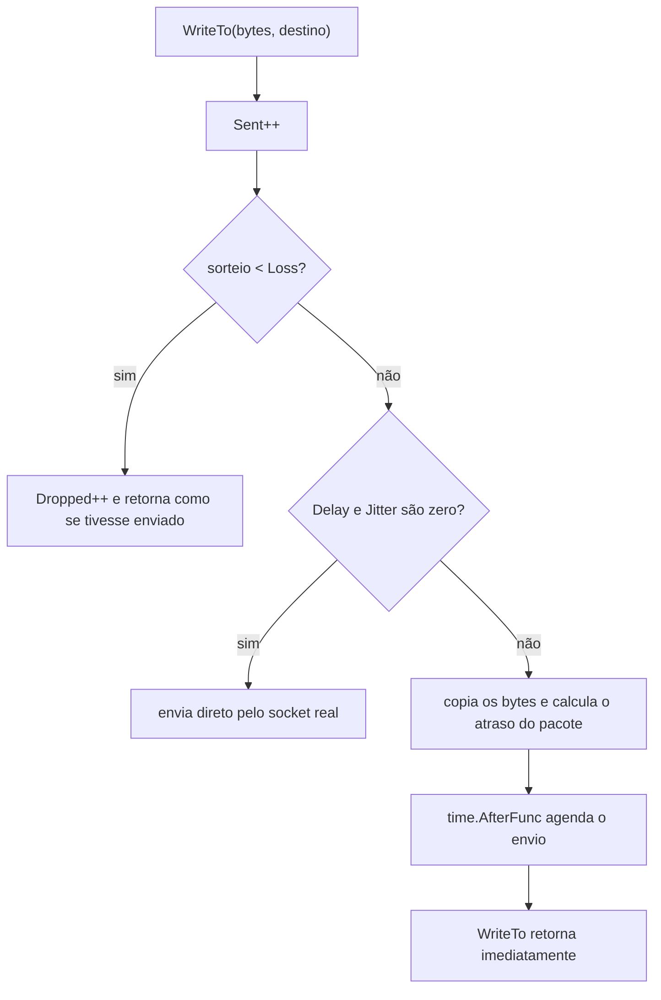
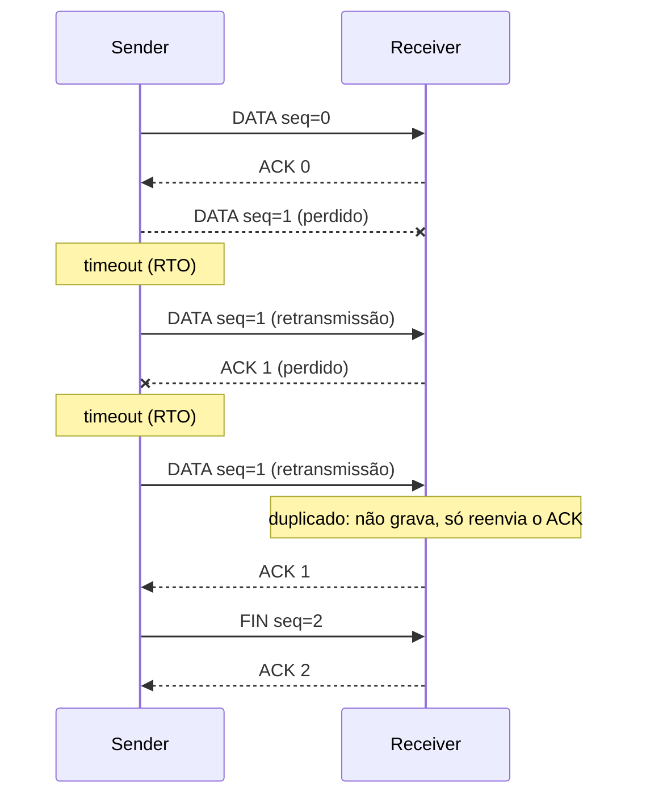
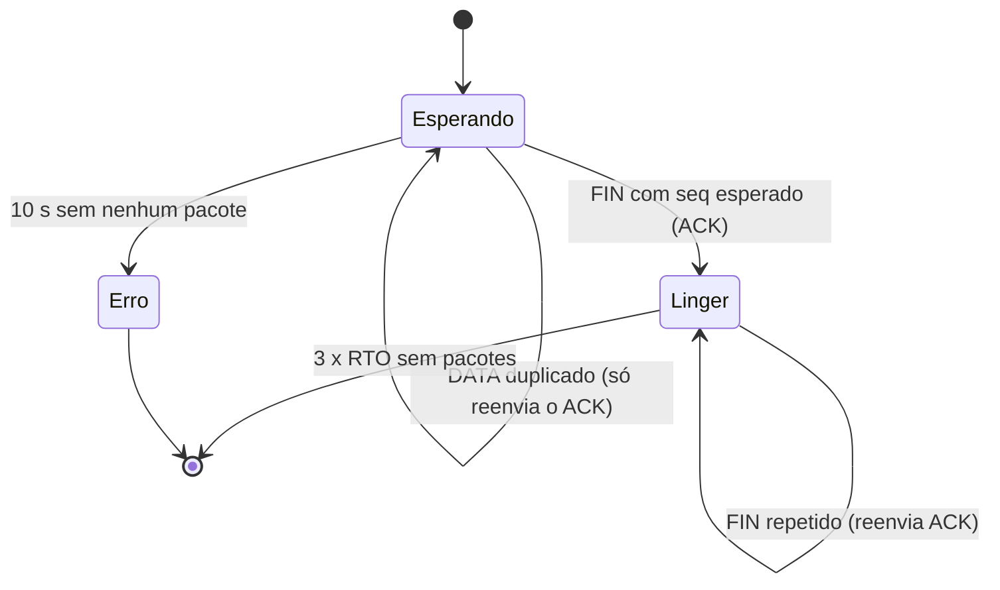
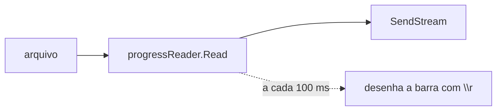

# Funcionalidades implementadas

Estado em 22/11/2026. Estrutura atual do projeto:

```
cmd/
  server/   contador de pacotes e fora de ordem
  client/   gerador de N pacotes com atraso, jitter e perda
  recv/     receptor de arquivo (teste do Stop-and-Wait)
  send/     remetente de arquivo com barra de progresso
internal/
  proto/      cabeçalho e codec de pacotes
  netem/      simulador de rede (atraso, jitter, perda)
  transport/  Stop-and-Wait (SendStream e RecvStream)
```

## Visão geral



---

## 1. Teste de conectividade UDP (hello world)

O primeiro teste foi um servidor que escuta em `:9000` e responde `world` a um
`hello`, e um cliente que envia e espera a resposta com timeout de 2 s.

Pontos importantes:
- O servidor usa `net.ListenPacket`, que devolve a interface `net.PacketConn`.
  Isso permite trocar o socket real pelo disfarce do `netem` sem mudar o resto.
- O cliente usa `ListenPacket` + `WriteTo` em vez de `Dial`, para que o mesmo
  socket consiga falar com mais de um servidor (necessário para o mini-CDN).
- O `SetReadDeadline` é o primeiro uso de timeout, base do RTO.

---

## 2. Pacote e cabeçalho (`internal/proto`)

Define o formato dos pacotes do protocolo, com 22 bytes de header seguidos do payload.

| Offset | Tamanho | Campo | Função |
|---|---|---|---|
| 0 | 1 | Type | tipo da mensagem (DATA, ACK, FIN...) |
| 1 | 1 | Flags | reservado para sinalizações |
| 2 | 2 | Window | janela anunciada pelo receptor |
| 4 | 4 | ConnID | identifica a sessão |
| 8 | 4 | Seq | número de sequência do pacote |
| 12 | 4 | Ack | número confirmado |
| 16 | 2 | Length | tamanho do payload |
| 18 | 4 | Checksum | CRC32 de todo o pacote |
| 22 | até 1200 | Payload | dados |

Todos os números são **big-endian** (ordem de rede). `MaxPayload` é 1200 bytes,
para evitar fragmentação IP.

Tipos definidos: HELLO, CHALLENGE, AUTH, AUTH_OK, LIST_REQ, LIST_RESP, GET, PUT,
META, DATA, ACK, FIN, ERR, PING, PONG. Hoje o transporte usa apenas DATA, ACK e FIN.

### `Marshal`: struct para bytes

O checksum é calculado com o campo zerado e depois gravado nele.



### `Unmarshal`: bytes para struct

Recusa o pacote em três situações antes de montar a struct.



Quem recebe um erro de `Unmarshal` descarta o pacote em silêncio. Para o
remetente isso equivale a uma perda e é resolvido por retransmissão.

### Testes

`TestRoundTrip` (ida e volta preserva todos os campos), `TestCorruptionDetected`
(byte alterado gera `ErrBadChecksum`) e `TestShort` (menos de 22 bytes gera `ErrShort`).

---

## 3. Simulador de rede (`internal/netem`)

Um disfarce sobre o `net.PacketConn`: tem a mesma interface do socket, mas
sobrescreve o `WriteTo` para simular perda, atraso e jitter. Todo o resto
(`ReadFrom`, `Close`...) vem do socket embutido.

Configuração:
- `Delay`: atraso de **um sentido**. Com os dois lados usando o `netem`, RTT = 2 x Delay.
- `Jitter`: variação máxima. O atraso de cada pacote fica entre `Delay - Jitter` e `Delay + Jitter`.
- `Loss`: probabilidade de descartar, de 0 a 1.

Contadores públicos: `Sent` e `Dropped`.



Observações:
- A cópia dos bytes é necessária porque quem chamou reaproveita o buffer.
- Como cada pacote tem seu próprio temporizador, o **jitter causa reordenação**, o que permite testar o receptor com pacotes fora de ordem.
- O programa que usa o `netem` deve esperar `Delay + Jitter` antes de terminar, senão os pacotes ainda agendados nunca são enviados.
- A perda é aplicada no envio, antes do socket. Por isso ela **não aparece** em uma captura do Wireshark.

---

## 4. Contador de pacotes e fora de ordem (`cmd/client` e `cmd/server`)

Ferramenta de validação do `proto` e do `netem`.

- **Cliente:** envia `-n` pacotes DATA (padrão 1000) com `Seq` de 0 a n-1, pelo `netem`, com pausa `-interval` entre envios. Imprime enviados e descartados.
- **Servidor:** conta quantos chegaram, quantos estavam **fora de ordem** (Seq menor que o maior já recebido) e quantos vieram corrompidos. Encerra a rodada após 2 s de silêncio e informa também os perdidos (`-expected` menos os recebidos).

Uso:

```bash
go run ./cmd/server -expected 1000
go run ./cmd/client -delay 50ms -jitter 20ms -loss 0.05
```

Resultados esperados: com atraso fixo e sem jitter, 0 fora de ordem; com jitter, vários; com perda de 5%, cerca de 50 perdidos.

---

## 5. Transporte confiável Stop-and-Wait (`internal/transport`)

Envia um fluxo de bytes (arquivo) por UDP de forma confiável e em ordem, um pacote
por vez. O motor é **simétrico**: `SendStream` e `RecvStream` serão usados tanto
por GET quanto por PUT, mudando só quem assume cada papel.

### Diálogo normal e com perdas



### Sender (`SendStream`)

1. Lê até 1200 bytes do arquivo (`io.ReadFull`). Se não leu nada, o pacote é um `FIN`.
2. Envia o pacote e espera o ACK com `Ack == Seq` até o prazo `rto`.
3. Se o prazo estoura, reenvia (conta como retransmissão). O limite é 20 tentativas; depois disso devolve erro.
4. ACKs antigos ou de outro tipo são ignorados e o sender continua esperando.
5. Pacotes corrompidos (checksum inválido) são descartados em `readPacket`, o que vira timeout e retransmissão.

### Receiver (`RecvStream`)



- O remetente é o primeiro endereço de onde chega um pacote válido; depois disso só ele é aceito.
- A fase **Linger** existe porque o ACK do FIN também pode se perder: o receptor fica 3 x RTO reenviando o ACK caso o sender repita o FIN.

### Estatísticas

`Stats` guarda pacotes enviados (incluindo retransmissões) e número de retransmissões.

### Limitações atuais

- RTO fixo, ajustado por flag (`-rto`). Deve ser maior que o RTT, ou haverá retransmissões sem necessidade.
- `ConnID` ainda não é usado, e o receptor atende um remetente por vez.
- Desempenho limitado a ~1 pacote por RTT (1200 B / RTT). Com RTT de 100 ms são ~12 KB/s, e 80 MB levariam quase 2 horas. É a justificativa para a janela deslizante.

---

## 6. Programas de teste de arquivo (`cmd/send` e `cmd/recv`)

Programas provisórios para exercitar o transporte antes de existirem GET e PUT.

- `recv`: escuta em `-addr`, grava em `-out` e aceita `-rto`, `-delay`, `-jitter`, `-loss`.
- `send`: envia `-file` para `-server` com as mesmas opções e, ao final, mostra bytes, tempo, pacotes e retransmissões.

```bash
go run ./cmd/recv -out recebido.bin
go run ./cmd/send -file t10.bin
sha256sum t10.bin recebido.bin   # os hashes devem ser iguais
```

---

## 7. Barra de progresso (`cmd/send`)

Um `progressReader` embrulha o arquivo (mesmo padrão de "disfarce" do `netem`).
Cada leitura soma os bytes e redesenha a barra, no máximo a cada 100 ms.



Mostra percentual, megabytes enviados, velocidade e retransmissões. Conta
bytes **lidos**, não confirmados: no Stop-and-Wait a diferença é de no máximo um
pacote. Com a janela deslizante deve passar a contar bytes confirmados.