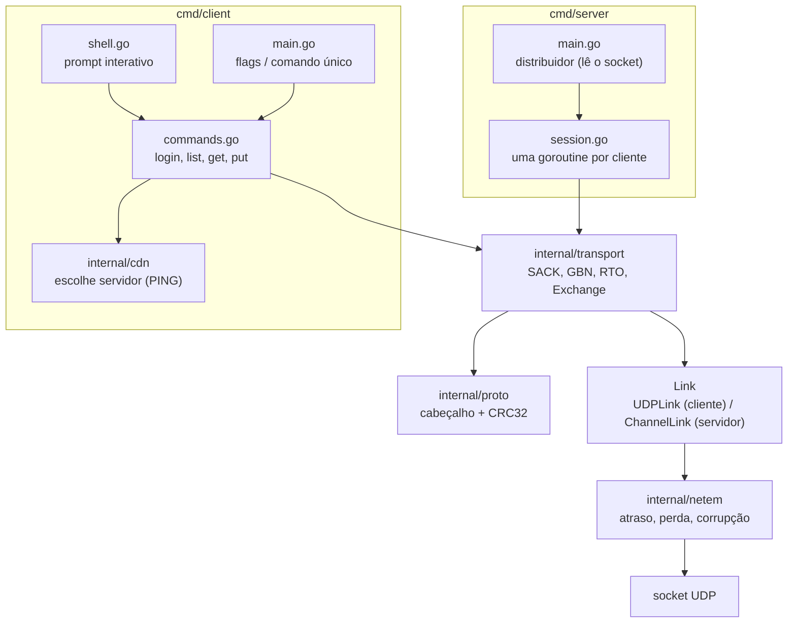
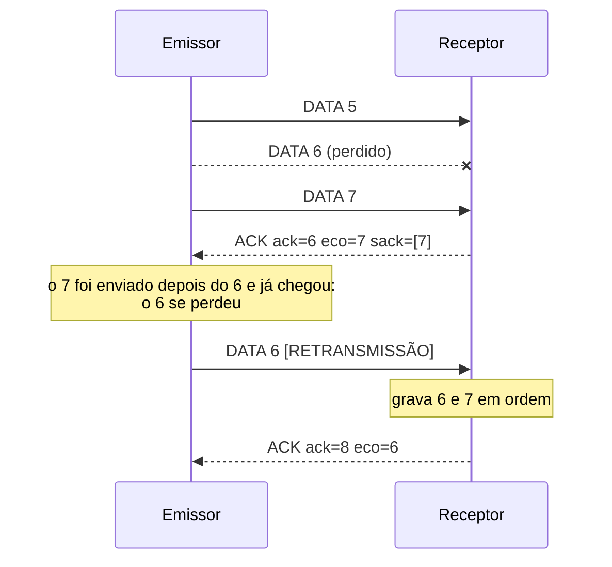
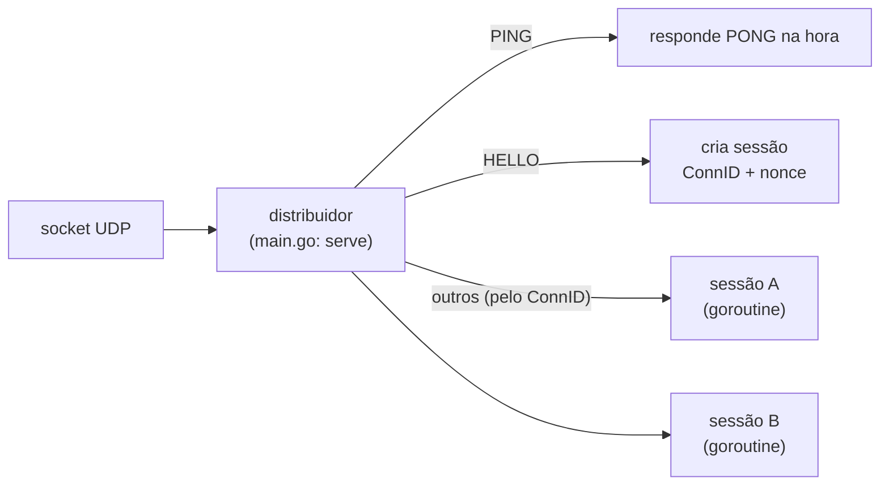
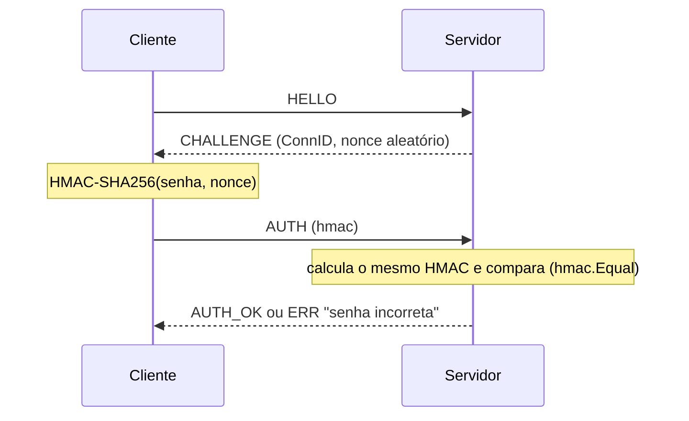

# Como o RAPOSA funciona por dentro

Guia de estudo do código. Cada seção diz **o que** a parte faz, **onde** está
e **por que** foi feita assim. No final há uma tabela ligando cada requisito
do enunciado ao código que o cumpre.

## Visão geral



Camadas, de baixo para cima:

1. **netem**: "disfarce" do socket que simula uma rede ruim nos envios.
2. **proto**: transforma `Packet` em bytes e de volta (`Marshal`/`Unmarshal`) e descarta pacotes corrompidos.
3. **transport**: a parte confiável. Janela deslizante, retransmissões, RTO e hash.
4. **cmd/server** e **cmd/client**: a aplicação (login, list, get, put, mini-CDN).

---

## 1. Cabeçalho (`internal/proto`)

Especificação completa em [header.md](header.md). Resumo: 30 bytes com
Type, Flags, Window, ConnID, Seq, Ack, Sack, Length e Checksum (CRC-32).

- `packet.go`: layout, tipos de mensagem, `Marshal` e `Unmarshal`.
- `messages.go`: payload dos pedidos (`algoritmo\njanela\nnome`), pacotes de
  erro (código + texto) e `AuthProof` (HMAC da senha).

`Unmarshal` recusa pacotes curtos, com tamanho inconsistente ou com CRC errado.
Quem recebe um erro descarta o pacote, e para o protocolo isso é igual a uma perda.

---

## 2. A conversa com o outro lado: `Link` (`transport/link.go`)

O GBN e o SACK não falam direto com o socket. Eles usam uma **interface**:

```go
type Link interface {
    Send(packet *proto.Packet) error
    Receive(deadline time.Time) (*proto.Packet, error)
}
```

Existem duas implementações:

- **UDPLink** (cliente): lê o socket direto e ignora pacotes de outros endereços ou de outra sessão.
- **ChannelLink** (servidor): a sessão recebe pacotes por um *channel* (`Inbox`), preenchido pelo distribuidor.

Assim o mesmo algoritmo roda nos dois lados, e os testes usam um terceiro
Link "de mentira", em memória (`transport_test.go`).

---

## 3. Janela deslizante

### Peças comuns (`transport/stream.go`)

- **packetSource** corta o arquivo em pedaços de 1200 bytes (DATA) e, no fim,
  gera um **FIN cujo payload é o SHA-256** de tudo que foi enviado.
- **streamReceiver** é a parte comum dos receptores:
  - grava os dados e calcula o hash;
  - no FIN, compara os hashes. Se forem iguais, confirma com ACK; se forem diferentes, responde `ERR` e o emissor falha;
  - antes do primeiro dado, reenvia o pedido (GET/LIST) se ele se perdeu, ou a resposta (OK do PUT).
- **Exchange** faz pedido e resposta com retransmissão (login, PUT).

### Go-Back-N (`transport/gbn.go`)

```
seq:   0   1   2   3   4   5   6   7   8   9
     [ok][ok][ ][ ][ ][ ][ ][ ][ ][ ]
              ^base           ^nextSeq
              |<--- no ar --->|
```

- O emissor mantém até `janela` pacotes no ar.
- O receptor só aceita o pacote esperado e descarta o resto.
- O ACK é cumulativo: `Ack = X` quer dizer "tenho tudo abaixo de X".
- **Timeout** do pacote mais antigo: reenvia **a janela inteira**.
- **3 ACKs repetidos**: reenvia a janela sem esperar o timeout (fast retransmit).
- Com janela 1, vira Stop-and-Wait.

Problema: com 5% de perda e janela 64, quase toda janela tem uma perda, e cada
perda reenvia até 64 pacotes. Daí o SACK.

### Selective Repeat com SACK (`transport/sack.go`)

- O receptor **guarda** os pacotes fora de ordem e grava em ordem quando o buraco é preenchido.
- Cada ACK diz ao emissor o que chegou de três formas:
  - `Ack`: cumulativo;
  - `Seq`: **eco**, o pacote que gerou este ACK;
  - `Sack`: bitmap dos 64 pacotes seguintes (redundância, caso algum ACK se perca).
- O emissor reenvia **só** os pacotes perdidos.



**Como o emissor decide que um pacote se perdeu** (ideia do RACK do TCP, RFC 8985):
se chegou um pacote enviado *depois* dele (com folga de RTT/4 para eventuais
trocas de ordem), então ele se perdeu. A regra também vale para retransmissões
perdidas, sem esperar timeout.

**Timeout**: se nada novo for confirmado por um RTO inteiro, reenvia tudo o
que está sem confirmação há mais de um RTO.

**Controle de fluxo**: o receptor anuncia em `Window` quanto espaço livre
ainda tem, e o emissor nunca passa de `min(janela própria, janela anunciada)`.

### RTO adaptativo (`transport/rto.go`)

Mesmo cálculo do TCP (RFC 6298):

```
primeira amostra: SRTT = R,  RTTVAR = R/2
depois:           RTTVAR = 0,75·RTTVAR + 0,25·|SRTT − R|
                  SRTT   = 0,875·SRTT + 0,125·R
RTO = SRTT + 4·RTTVAR   (mínimo 200 ms, começa em 1 s)
```

- O RTT é medido pelo **eco** do ACK, e só para pacotes nunca retransmitidos (regra de Karn).
- A cada timeout, o RTO dobra (backoff) até chegar uma medição nova.
- `-rto 300ms` força um valor fixo.

---

## 4. Servidor (`cmd/server`)



- **Distribuidor**: uma goroutine que lê o socket e entrega cada pacote à sessão dona do `ConnID`. Ela nunca trava: se a fila da sessão estiver cheia, o pacote é descartado (como numa perda).
- **Sessão** (`session.go`): uma goroutine por cliente, que trata AUTH, LIST, GET e PUT.
  - **Pedidos repetidos**: cada pedido tem um número (campo Seq). Um número já tratado só faz a sessão reenviar a resposta guardada.
  - **Upload**: grava num arquivo temporário e só renomeia depois de o hash conferir.
  - **Nome seguro**: aceita só nomes simples (`filepath.Base`), então `../../etc/passwd` é recusado.
  - `recover`: um erro inesperado derruba só aquela sessão, não o servidor.
  - Encerra depois de 60 s sem pedidos, ou depois de 3 senhas erradas.
- O mapa de sessões é protegido por um `sync.Mutex`, porque várias goroutines mexem nele.

### Login sem mandar a senha



Quem captura o tráfego vê só o nonce e o HMAC. Como o nonce muda a cada
conexão, repetir o HMAC capturado não funciona.

---

## 5. Cliente (`cmd/client`)

- `main.go`: flags. Sem comando, abre o modo interativo; com comando, executa e sai.
- `shell.go`: prompt com a biblioteca `ergochat/readline` (histórico, TAB, senha mascarada).
- `commands.go`: mini-CDN, login, list, get e put. Se o servidor responder "sessão desconhecida" (servidor reiniciou ou a sessão expirou), `withSession` refaz o login e repete o comando.
- `report.go`: resumo na tela e linha no CSV.
- `progress.go`: barra de progresso.

Tempos que se ajustam ao RTT medido no ping:

- **reenvio de pedido**: `max(2·RTT, 200 ms)`;
- **linger** (continuar confirmando o FIN depois do fim, caso a confirmação se perca): `3 ×` o tempo de reenvio.

---

## 6. Mini-CDN (`internal/cdn`)

1. Para cada servidor, envia N pings (padrão 5) e mede o tempo até o PONG.
2. Usa a **mediana**, que não é distorcida por um ping atrasado.
3. Escolhe o menor RTT e mostra a tabela com o escolhido marcado com `*`.

É o mesmo princípio do mapeamento das CDNs: direcionar o cliente para a réplica
"mais próxima" em atraso. As CDNs reais fazem isso via DNS ou anycast, com
medições agregadas de muitos clientes.

---

## 7. Simulador de rede (`internal/netem`)

Embrulha o socket e, a cada `WriteTo`:

1. com probabilidade `Loss`, descarta o pacote;
2. com probabilidade `Corrupt`, inverte um byte (o CRC do outro lado descarta);
3. com `Delay`/`Jitter`, põe o pacote numa **fila única** que o envia na hora certa.

A fila única mantém a ordem dos pacotes. Timers separados por pacote
reordenariam tudo, e o GBN descartaria pacotes bons.

---

## 8. Requisitos do enunciado → código

| Requisito | Onde |
|---|---|
| Servidor lista arquivos | `session.go: sendList` |
| Download / upload | `session.go: sendFile / receiveFile`, `commands.go: download / upload` |
| Autenticação por senha | `session.go: handleAuth`, `proto.AuthProof` |
| Cliente conecta e pede a lista | `commands.go: login, list` |
| Tratar exceções e mensagens de erro | pacotes `ERR` com código (`proto/messages.go`), `recover` por sessão, mensagens no cliente |
| Detectar falhas de comunicação | `maxRetries` (20 timeouts seguidos), `idleTimeout`, sessão expirada → novo login |
| Detectar dados corrompidos | CRC-32 por pacote (`proto.Unmarshal`), SHA-256 do arquivo (FIN) |
| Entrega confiável e em ordem | `gbn.go`, `sack.go` (ACK, reordenação no receptor) |
| Retransmissão, perdas, timeout | `handleTimeout`, `retransmitLost`, fast retransmit, `rto.go` |
| Cabeçalho próprio documentado | `proto/packet.go`, [header.md](header.md) |
| Janela deslizante | GBN e SACK, `-window` |
| Hash original e recebido | impressos pelo cliente (get) e pelo servidor (put) |
| RTT, throughput, perda, retransmissões | `report.go`, CSV, `scripts/bench.sh` |
| 4 cenários, arquivo ≥ 80 MB, gráficos | `scripts/bench.sh`, `scripts/plot.py` |
| Mini-CDN com seleção automática | `internal/cdn`, `-servers a,b` |
| Wireshark: ACKs e retransmissões | `tools/wireshark/raposa.lua`, flag `RETRANS` |
